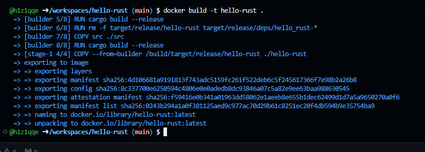
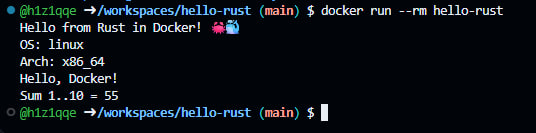
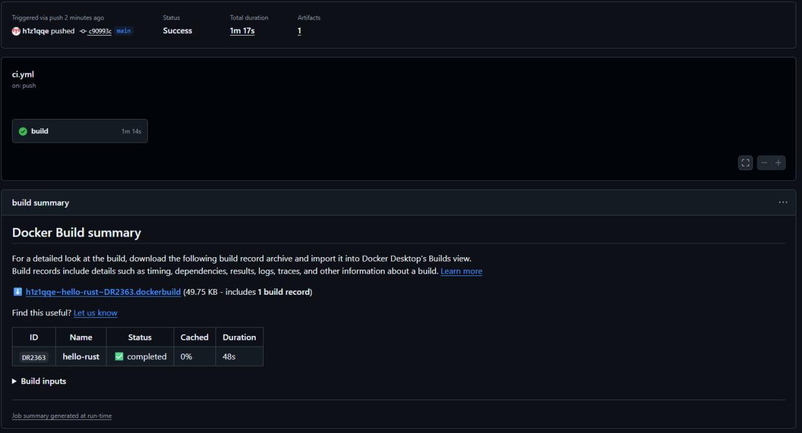
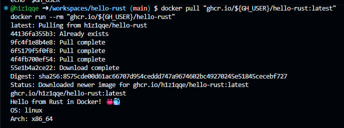

<div align="center">

# 🦀 hello-rust

**Лабораторная работа: CI/CD для Rust — от `cargo fmt` до Docker-образа в GitHub Container Registry**

[](https://github.com/h1z1qqe/hello-rust/actions/workflows/ci.yml)
[](https://github.com/users/h1z1qqe/packages/container/package/hello-rust)
[](https://codespaces.new/h1z1qqe/hello-rust)

```bash
docker pull ghcr.io/h1z1qqe/hello-rust:latest
```

*Вся работа — код, тесты, сборка образа и публикация — выполнена в облаке, в GitHub Codespaces.*

</div>

---

## 📖 О проекте

Учебный проект, демонстрирующий полный цикл **CI/CD**: при каждом push в `main` GitHub Actions проверяет код (форматирование, линтер, тесты), собирает минималистичный Docker-образ и публикует его в **GHCR** — реестре контейнеров GitHub. Никаких отдельных учётных записей и ручных токенов: публикация выполняется встроенным `GITHUB_TOKEN`, который выдаётся каждому запуску workflow автоматически.

Ключевое отличие **CI** от **CI/CD**:

- **CI** (Continuous Integration) — код проверяется: `fmt`, `clippy`, `test`, `docker build`;
- **CI/CD** (Continuous Delivery) — то же самое, плюс образ публикуется в реестр и сразу готов к развёртыванию на любой машине с Docker.

## ✅ Проделанная работа

| # | Этап | Инструменты | Результат |
|---|---|---|---|
| 1 | Создание репозитория и запуск Codespace | GitHub, Codespaces | облачная среда с предустановленными `git`, `gh` и Docker |
| 2 | Каркас проекта | cargo | библиотека + CLI-приложение, 4 теста (unit + интеграционные) |
| 3 | Multi-stage `Dockerfile` | Docker | компиляция в `rust:1-slim`, запуск в `debian:stable-slim` |
| 4 | Локальные проверки | `cargo fmt` / `clippy` / `test` | 0 замечаний линтера, **4 passed** |
| 5 | Локальная сборка и запуск | `docker build` / `docker run` | образ собран, вывод корректен — скриншоты 1–2 |
| 6 | Публикация кода | `git push` (коммит `c90993c` → `main`) | автоматически запустил workflow |
| 7 | Прогон CI/CD-конвейера | GitHub Actions | **Success за 1m 17s** — скриншот 3 |
| 8 | Публикация образа | GHCR + `GITHUB_TOKEN` | `ghcr.io/h1z1qqe/hello-rust:latest` + `:c90993c` |
| 9 | Проверка образа из реестра | `docker pull` / `docker run` | вывод идентичен локальному — скриншот 4 |

### 📊 Итоги CI-прогона

| Метрика | Значение |
|---|---|
| Коммит | [`c90993c`](https://github.com/h1z1qqe/hello-rust/commit/c90993c) — push в `main` |
| Статус workflow | ✅ **Success** |
| Общее время прогона | **1m 17s** |
| Job `build` | 1m 14s |
| Docker-сборка в CI | 48s (запись `DR2363`, артефакт сборки 49.75 KB) |
| Тесты | 4 passed, 0 failed |

## ⚙️ Как работает конвейер

```text
push в main (c90993c)
   │
   ▼
┌──────────────────────────────────────────────────────┐
│   GitHub Actions — workflow «Rust CI/CD»             │
│                                                      │
│   1. cargo fmt --check          форматирование  ✅   │
│   2. cargo clippy -D warnings   линтер          ✅   │
│   3. cargo test                 4 passed        ✅   │
│   4. cargo build --release      release-сборка  ✅   │
│   5. docker build               multi-stage     ✅   │
│   6. docker push                → GHCR          ✅   │
└──────────────────────────────────────────────────────┘
   │
   ▼
ghcr.io/h1z1qqe/hello-rust:latest  +  :c90993c
(digest sha256:8575cd0e…)
```

Образ собирается в два этапа: в `builder` (на базе `rust:1-slim`) компилируется release-бинарник, затем он копируется в чистый `debian:stable-slim` и запускается от непривилегированного пользователя `appuser`. В финальный образ не попадают ни компилятор, ни исходники, ни cargo-кэш — только бинарник размером в несколько мегабайт.

## 🖼 Скриншоты

### 1. Сборка Docker-образа в Codespaces

`docker build -t hello-rust .` — multi-stage сборка: стадии builder и runtime, экспорт слоёв и итогового образа `hello-rust:latest`.



### 2. Запуск контейнера локально

`docker run --rm hello-rust` — приложение выводит приветствие, платформу, результат функции `greet()` из библиотеки и сумму чисел 1..10.



### 3. GitHub Actions — успешный CI/CD-прогон

Workflow «Rust CI/CD» завершился со статусом **Success за 1m 17s** после пуша коммита `c90993c`. В summary видна статистика Docker-сборки: запись `DR2363`, время 48s.



### 4. Проверка образа из реестра GHCR

`docker pull ghcr.io/${GH_USER}/hello-rust:latest` — образ скачан из реестра (digest `sha256:8575cd0e…`), затем `docker run` — вывод полностью совпадает с локальной сборкой.



## 🚀 Запуск

### Образ из реестра (публичный, без авторизации)

```bash
docker pull ghcr.io/h1z1qqe/hello-rust:latest
docker run --rm ghcr.io/h1z1qqe/hello-rust
```

### Локальная сборка из исходников

```bash
git clone https://github.com/h1z1qqe/hello-rust.git
cd hello-rust
docker build -t hello-rust .
docker run --rm hello-rust
```

Ожидаемый вывод:

```text
Hello from Rust in Docker! 🦀🐳
OS: linux
Arch: x86_64
Hello, Docker!
Sum 1..10 = 55
```

<details>
<summary><b>Запустить тесты без установки Rust</b> (в контейнере)</summary>

```bash
docker run --rm \
  -u "$(id -u):$(id -g)" \
  -e HOME=/tmp -e CARGO_HOME=/tmp/.cargo \
  -v "$(pwd)":/app \
  -w /app \
  rust:1-slim \
  cargo test
```

</details>

## 🗂 Структура проекта

```text
hello-rust/
├── .github/
│   └── workflows/
│       └── ci.yml          # конвейер CI/CD → GHCR
├── docs/
│   └── screenshots/        # скриншоты для README
├── src/
│   ├── main.rs             # CLI-приложение
│   └── lib.rs              # greet() и sum_range() + unit-тесты
├── tests/
│   └── integration.rs      # интеграционные тесты
├── Dockerfile              # multi-stage: rust:1-slim → debian:stable-slim
├── Cargo.toml              # release-профиль: opt-level "z", LTO, strip
├── .dockerignore
└── .gitignore
```

## 🧱 Технологии

| Технология | Как используется |
|---|---|
| **Rust 2021** | библиотека + CLI; release-сборка ужата до минимума (`opt-level = "z"`, LTO, strip) |
| **Docker multi-stage** | компиляция в `rust:1-slim`, запуск в `debian:stable-slim` под непривилегированным пользователем `appuser` |
| **GitHub Actions** | fmt → clippy → test → build → push; кэширование cargo-реестра и Docker-слоёв |
| **GHCR** | автоматическая публикация образа с тегами `latest` и коротким SHA коммита |
| **GitHub Codespaces** | облачная среда разработки: Docker, git и gh CLI предустановлены и авторизованы |

## 🧪 Тесты

| Набор | Тесты | Что проверяют |
|---|---|---|
| Unit (`src/lib.rs`) | `test_greet`, `test_sum_range` | функции `greet()` и `sum_range()` |
| Integration (`tests/integration.rs`) | `integration_test_greet`, `integration_test_sum_large` | публичный API библиотеки через `use hello_rust::…` |

## 🔗 Полезные ссылки

- [Репозиторий](https://github.com/h1z1qqe/hello-rust) — исходный код
- [Workflow «Rust CI/CD»](https://github.com/h1z1qqe/hello-rust/actions/workflows/ci.yml) — история запусков
- [Пакет в GHCR](https://github.com/users/h1z1qqe/packages/container/package/hello-rust) — версии образа и инструкция pull